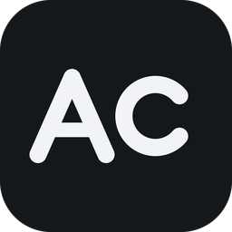

<div align="center">



# aicross

[下载](https://github.com/keros68/aicross/releases/latest) · [快速开始](#快速开始) · [使用说明](docs/MANUAL.md) · [开发说明](#从源码构建) · [许可证](#许可证)

**把任务派给本机多家 AI 编程 Agent 分工完成，用其他厂商的模型交叉审查，结果并排交给你采纳。**

</div>

aicross 是基于 Tauri 2 的桌面应用，配合 ai-cross skill 使用，目前提供 Windows 安装包。平时用哪个 Agent 都可以：在面板里分好谁出方案、谁执行、谁审查，回到原来的软件里说一句话就开始协作。各家命令行工具在本机运行，无云端服务。

本仓库同时包含面板（`src/`、`src-ui/`）与 ai-cross skill 源码（[`skills/ai-cross`](skills/ai-cross/)）。skill 不装面板也能用；装了面板后，派给谁在面板里设，不用在对话里另做盘点。

## 功能

- **三步上手**：「开始」页探测本机装了哪些 Agent 和模型，选平时用的软件后「一键配好」（装 skill、按推荐分好人选），复制示例回去说一句。不用写配置文件，不用记命令。
- **不挑主 Agent**：Claude Code、Codex、Kimi Code、OpenCode、Qoder 等都能当主 Agent，探测时自动发现；换着用时各自一份配置，互不影响。
- **六种协作模式**：共享、经济、盲审、擂台、评审、蜂群，也能自建。审查请求默认用盲审模式，干活默认用经济模式。
- **跨厂商交叉验证**：审查者默认避开被审产出的厂商；盲审时每一路在单独目录运行，只收到原始材料和中性问题，看不到我方结论和其他路的结果。
- **核对模型真身**：第三方端点可能把不认识的模型名静默换成默认模型。首次派发前发一个短请求比对响应里的模型名，不符的记「验证失败」，不派发。
- **用户裁决**：派发前先说明发给谁、发什么，同意后才发送；各路结果在查看页并排，由用户选定采纳，不做多数表决。
- **可追溯**：每次派发记录任务原文、应答模型和原始输出；引擎中途退出后可用 `aicross recover` 核对，并按快照恢复改了一半的项目文件。
- **自动更新**：有新版时顶栏提示，点一下下载、校验签名并安装；aicross 装的 skill 随软件一起更新，其他软件装的旧版 skill 点「升级」即可换成新版。

## 快速开始

1. 本机装好并登录至少两家 Agent 的命令行工具（Claude Code、Codex、Kimi Code、pi agent 等）。只有一家时，无法交给其他厂商审查。
2. 打开 [Releases](https://github.com/keros68/aicross/releases/latest)，下载 `aicross_*_x64-setup.exe` 或 `.msi`，装一个即可。安装后命令行里可用 `aicross`。
3. 进「开始」页：探测本机 Agent 与模型，选在哪个软件里用，点「一键配好」。手选的人选和其他软件管理的 skill 不改动。
4. 回到该软件，输入页面给出的示例，例如 `/ai-cross 让别家审一下 main.py`。要换人选，到「模式」页改。

只用 skill、不装面板时：

```bash
npx skills add keros68/aicross --skill ai-cross -g
```

用 `-a claude-code -a codex -a kimi-code-cli -a pi` 指定 Agent。之前从 `keros68/xiaoyu-skill` 装的，先 `npx skills remove ai-cross -g` 再按上面重装。

面板各页、命令行子命令、退出码与脱敏规则见[使用说明](docs/MANUAL.md)，命令行契约见 [docs/CONSOLE-CHANNEL.md](docs/CONSOLE-CHANNEL.md)。

## 协作模式

| 模式 | 做法 |
| --- | --- |
| 共享模式 | 单个模型执行，可读取完整对话上下文；只读 |
| 经济模式 | 高档模型出方案，低档模型执行，其他厂商的模型验收；额度用尽时按备选顺序改派 |
| 盲审模式 | 同一份材料由多个厂商的模型独立审查，结果互不可见 |
| 擂台模式 | 多个模型分别完成同一任务，从结果中选定一份采纳 |
| 评审模式 | 多个模型分别从安全、性能、需求覆盖角度审查 |
| 蜂群模式 | 任务拆分为互不重叠的子任务，由多个模型并行完成后合并 |

## 支持的 Agent

| Agent | 当主 Agent | 接受派发 |
| --- | --- | --- |
| Claude Code | ✅ | ✅ |
| Codex | ✅ | ✅ |
| Kimi Code | ✅ | ✅ |
| pi agent | ✅ | ✅ |
| Antigravity | ✅ | 仅纯文本盲审 |
| WorkBuddy / CodeBuddy | ✅ | 仅盲审位置（未实测） |
| Qoder（含国内版） | ✅ | 仅盲审位置（未实测） |
| OpenCode | ✅ | ❌ |
| Gemini CLI | ✅ | ❌ |
| Hermes Agent | ✅ | ❌ |
| ZCode | ✅ | ❌ |
| Cursor | ❌ | 仅盲审位置（未实测） |
| GitHub Copilot CLI | ❌ | 仅盲审位置（未实测） |

盲审位置只读、看不到项目文件。未实测的通道按官方文档写命令，只接这类位置。

## 数据与密钥

- 程序数据在 `~/.aicross/`，卸载不删。
- 密钥只经子进程环境变量传给各家命令行工具，不写入 aicross 自己的文件，不进模型上下文。
- 发出的任务文本默认脱敏，认得 PEM 私钥、Bearer 令牌、password / token / api_key 赋值等常见形态；裸写的 `sk-…` 之类认不出来，规则见[使用说明](docs/MANUAL.md)「密钥与脱敏」。

## 从源码构建

依赖 Node.js、Rust（stable）与 Tauri 2 的系统依赖。macOS 与 Linux 目前只保证能编译，没有安装包。

```bash
cd src-ui && npm install && npm run build   # 前端
cargo check && cargo test                   # 后端（仓库根目录）
npx --yes -p @tauri-apps/cli@2 tauri dev    # 开发窗口
```

修改 `skills/ai-cross` 后运行 `python scripts/sync-skill.py` 更新内置包。

## 相关项目

- [yourmem](https://github.com/keros68/yourmem)：在本机归档和搜索各 Agent 的对话原文，保存项目记忆。
- [Metrik](https://github.com/keros68/metrik)：查看各 Agent 的剩余额度、重置时间和 Token 用量。aicross 不统计额度，需要看额度时使用 Metrik。

## 许可证

[MIT](LICENSE)，Copyright © 2026 keros68。
